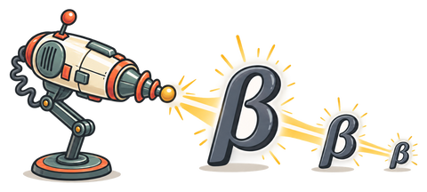

# Shrinkage for Python 

[](https://github.com/jolars/shrinkage/actions/workflows/ci.yml)
[](https://pypi.org/project/shrinkage/)
[](https://doi.org/10.5281/zenodo.23613100)

Shrinkage fits regression models with penalties that shrink coefficients, select
features, or encourage structure. It supports linear and logistic regression
with NumPy arrays, with the numerical work handled by Rust. Start with `Lasso`
for linear regression with feature selection, or combine losses, penalties, and
solvers to build other models.

See the [Python API reference](https://shrinkage.cc/packages/python/) for
classes and methods, and the [documentation](https://shrinkage.cc/) for model
guides and examples.

## Installation

Install [shrinkage](https://pypi.org/project/shrinkage/) from PyPI:

```sh
pip install shrinkage
```

Python 3.11 or newer is required. NumPy 2.0 or newer is installed automatically.
Wheels are available for Linux and Windows x86-64 and for macOS Intel and Apple
Silicon.

## Usage

Fit a lasso model and predict from a matrix whose rows are observations and
columns are features:

```python
import numpy as np
from shrinkage import Lasso

X = np.array([[0.0, 1.0], [1.0, 0.0], [2.0, 1.0], [3.0, 2.0]])
y = np.array([1.0, 3.0, 5.0, 7.0])

fit = Lasso(0.1).fit(X, y)

print(fit.coefficients)
print(fit.intercept)
print(fit.predict(X))
```

By default, `Lasso` standardizes features and fits an intercept without
penalizing it. Returned coefficients and the intercept use the original input
scale. Check `fit.termination` to see whether the solver converged or reached
its iteration limit.

## Other models

Combine a loss, a penalty, and a solver for other models. For example, clustered
lasso encourages coefficients to be equal as well as shrinking them toward zero:

```python
from shrinkage import ClusteredLasso, Gaussian, HybridCoordinateDescent, Problem

problem = Problem(X, Gaussian(y), ClusteredLasso(l1=0.1, fusion=0.05))
fit = problem.fit_with(HybridCoordinateDescent())
predictions = fit.predict(X)
```

For logistic regression, use `Binomial(y)` with responses of zero or one.
Binomial predictions are logits; convert them to probabilities with
`np.exp(-np.logaddexp(0, -fit.predict(X)))`.

Other structured penalties include `ChainFusedLasso`, which encourages
neighboring coefficients to be equal, and `Slope`, which penalizes coefficients
by their rank in magnitude. Both work with Gaussian and binomial models. See the
[model guides](https://shrinkage.cc/modeling/) for choosing a penalty.

## Regularization paths

Fit a range of penalty strengths to explore how the coefficients change:

```python
from shrinkage import PathOptions

path = problem.fit_regularization_path_with(
    HybridCoordinateDescent(),
    PathOptions(nlambda=20),
)
print(path.lambdas)
print(path.coefficients)
```

Paths reuse previous fits to reduce computation. Each row of `path.coefficients`
corresponds to one penalty strength. You can also supply an explicit sequence of
penalties with `problem.fit_path_with(...)`.

## Dense input contract

Pass dense NumPy arrays with finite `float64` values: a two-dimensional `X` with
shape `(n_samples, n_features)` and a one-dimensional `y` with shape
`(n_samples,)`. Use `np.asarray(data, dtype=np.float64)` to convert other
numeric input. Fitting copies the inputs, so later changes to your arrays do not
change the fitted model.

## Citation

If you use Shrinkage in your research, please cite the release you used. Select
that release in the [Zenodo archive](https://doi.org/10.5281/zenodo.23613100)
and export its citation.

## Contributing

See the [contribution
guide](https://github.com/jolars/shrinkage/blob/main/CONTRIBUTING.md) for setup
and checks.

## License

Shrinkage is licensed under the [MIT
license](https://github.com/jolars/shrinkage/blob/main/LICENSE).
